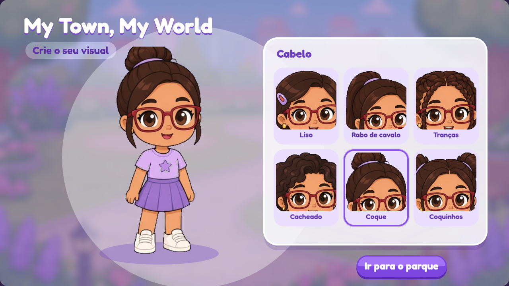
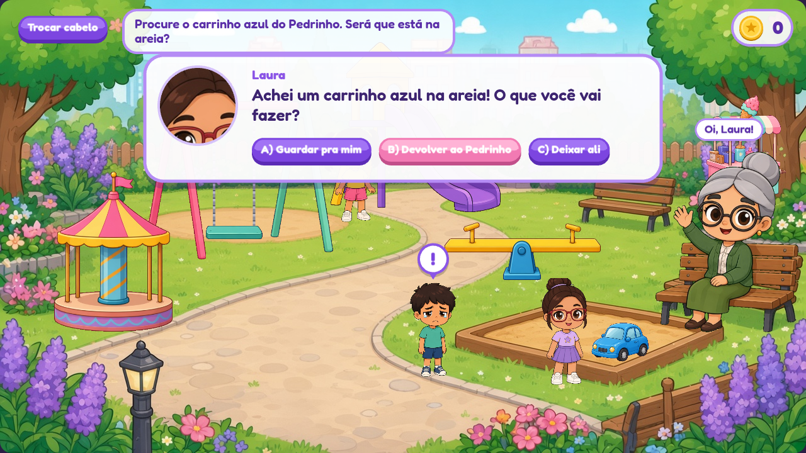

# My Town, My World (Minha Cidade, Meu Mundo)

[](https://github.com/fideliscoding/avatar-laura/actions/workflows/deploy.yml)

[Jogar My Town, My World](https://fideliscoding.github.io/avatar-laura/)

Jogo para a Laura (9 anos) criar o próprio visual, passear por uma cidade em estilo chibi lilás e aprender valores do dia a dia (honestidade, empatia, gentileza, responsabilidade, cuidado com os outros e com o mundo) por meio de missões curtas com escolhas.

Inspirado no estilo de jogos de "vida em cidade" para crianças, **sem copiar** personagens, nomes, telas ou artes de nenhum jogo existente. Sem emojis em lugar nenhum.




## O que já funciona (versão 0.1)

- Tela **Crie o seu visual** com 6 cabelos (Liso, Rabo de cavalo, Tranças, Cacheado, Coque, Coquinhos).
- **Parque** com balanço, escorregador, gangorra, carrossel, carrinho de sorvete, caixa de areia, Bia (amiga que passeia), Dona Marta (vovó no banco) e Pedrinho.
- Andar tocando no chão ou arrastando a Laura até um brinquedo.
- **Missão "O carrinho do Pedrinho"** (honestidade e empatia) com escolhas A/B/C, conselho gentil nas escolhas erradas, confete e +15 moedas.
- Progresso salvo no navegador (cabelo, moedas, missões).

Este código é a portabilidade do protótipo aprovado (`prototype/my-town-my-world.html`) para Phaser 3 + Vite + TypeScript.

## Tecnologias (todas gratuitas)

| Parte | Ferramenta |
|---|---|
| Motor do jogo | Phaser 3.90.0 |
| Build | Vite 7.3.7 + TypeScript 5.9.3 |
| Testes | Vitest 4.1.12 e Playwright 1.64.1 |
| Mapas (próximas etapas) | Tiled (arquivos .tmj em `public/assets/mapas/`) |
| Contas, banco e multiplayer (etapas 03 e 04) | Supabase JS 2.118.0 (Auth, Postgres com RLS, Realtime) |
| Hospedagem | GitHub Pages via GitHub Actions |

## Como rodar no computador

Precisa do [Node.js 22](https://nodejs.org/) (a partir do 22.12; o SDK Supabase atual exige Node 22).

```bash
npm install
npm run dev        # abre em http://localhost:5173/avatar-laura/
npm test           # testes de lógica
npm run build      # gera a pasta dist/
npm run preview    # serve o dist/ para conferir
npm run check:emojis
npx playwright install --with-deps chromium  # uma vez, instala o navegador de teste
npm run test:e2e   # build + vite preview + testes offline de navegador
npm run test:e2e:contas  # cadastro e entrada com servidor simulado
```

## Validação do port (etapa 01)

O teste de navegador escolhe Cacheado, recarrega o visual, conversa com Pedrinho,
cava a areia, confere os conselhos A/C e devolve o carrinho. Verifica 15 moedas no
`localStorage` (`mtmw:progresso:v1`) e repete a história sem pagar novamente.
Também cobre toque no chão, arrasto, brinquedos, falas e celular nas duas orientações.
As capturas em `docs/screenshots/phaser/` são atualizadas pelos testes.
O e2e usa o renderer Canvas para funcionar sem GPU; a captura do criador e
a comparação visual no servidor de desenvolvimento também foram feitas em WebGL.

O CI executa build, Vitest, verificação de emojis e Playwright nos PRs. O workflow
de deploy continua sem e2e. Posições, raios e velocidades ficam em
`src/config/parque.ts`. O favicon vetorial lilás foi mantido após revisão em tamanho pequeno.

## Jogo no celular e movimentos (etapa 03A)

O jogo ocupa a tela em retrato e paisagem. No parque, a câmera acompanha a Laura;
use o chão para andar e os atalhos do rodapé para visitar brinquedos e amigos.
Os controles e diálogos mantêm tamanho de leitura e toque, sem reduzir toda a
interface a uma miniatura. Girar a tela preserva o cabelo e a missão em andamento.
O formulário de conta também se adapta à área restante quando o teclado abre.

Os personagens têm articulação de braços, pernas e cabeça com as artes atuais:
passos, respiração, aceno, dança e poses para os brinquedos. Há limitações de
recorte e ainda faltam folhas desenhadas de poses/vistas, documentadas em
[docs/ARTE.md](docs/ARTE.md). [Capturas e vídeo](docs/screenshots/mobile/README.md).

## Contas e progresso na nuvem (etapa 03)

Sem configuração, o jogo continua abrindo direto no criador e salvando no navegador.
Com Supabase configurado, aparece **Entrar como responsável**, com cadastro por
apelido, e-mail e senha do adulto, ou **Jogar sem conta**. O parque mostra o apelido
e o botão **Sair**. A criança não precisa fornecer e-mail nem outros dados pessoais.

A conta recupera cabelo, missões e saldo oficial do servidor. O progresso do
convidado fica separado de cada conta. Ações feitas sem rede entram em uma fila
por usuário; o jogo mostra um aviso discreto e tenta reenviar a cada 15 segundos.
Moedas online só mudam após a resposta da função do servidor. O saldo do
`localStorage` nunca é promovido a saldo oficial.

Copie `.env.example` para `.env.local` e preencha somente a URL base e a chave
pública. No GitHub, configure os dois secrets públicos de build antes de publicar.
Aplique as migrações na ordem. Instruções e validação em [docs/SUPABASE.md](docs/SUPABASE.md).

## Publicar

Cada push na branch `main` publica automaticamente em `https://fideliscoding.github.io/avatar-laura/`. Passo a passo em [docs/DEPLOY.md](docs/DEPLOY.md) e, bem simples, em [GUIA-DO-BRUNO.md](GUIA-DO-BRUNO.md).

## Mapa do repositório

```
AGENTS.md                 regras para o Codex (ler antes de qualquer tarefa)
GUIA-DO-BRUNO.md          passo a passo para subir e conduzir o projeto
docs/                     GDD, roadmap, arte, Supabase, deploy, screenshots e referências
prompts/                  pedidos prontos para colar no Codex, um por etapa
prototype/                protótipo HTML aprovado (referência visual e de comportamento)
public/assets/            imagens (PNG transparentes), cenário e fonte
src/                      código do jogo (cenas, lógica, interface)
tests/                    testes Vitest
supabase/migrations/      SQL do banco com RLS
.github/workflows/        deploy no Pages e CI dos PRs
```

## Segurança infantil

Sem chat livre: toda comunicação é por frases prontas. Sem coleta de dados pessoais da criança além de um apelido. Conta criada pelo responsável. Detalhes em `AGENTS.md` e `docs/SUPABASE.md`.

## Créditos

Fonte Fredoka (SIL Open Font License 1.1). Artes geradas para este projeto.
